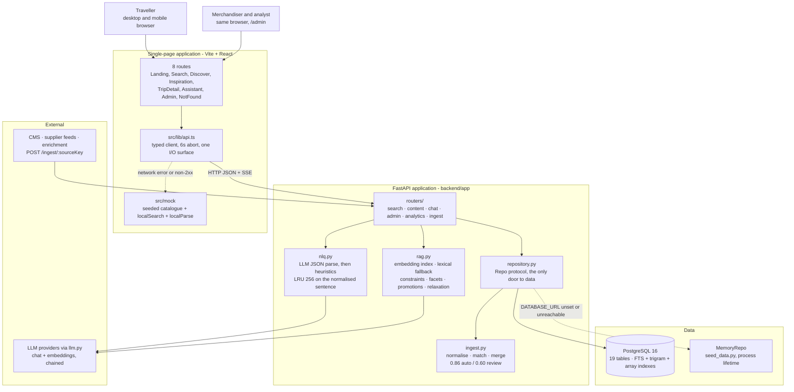
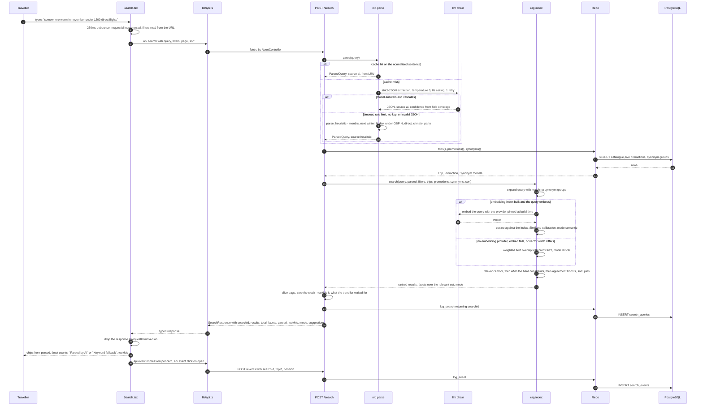
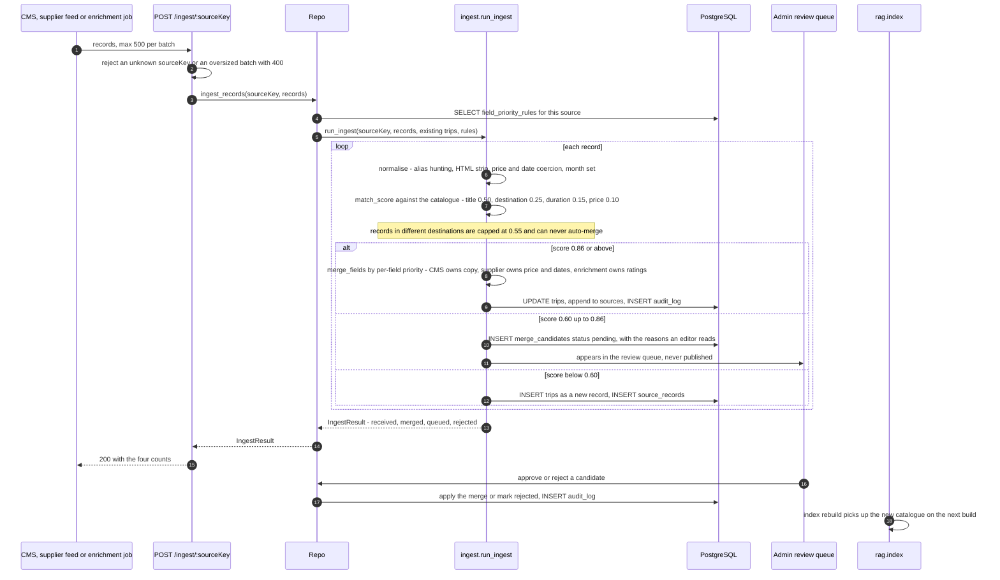

# Architecture — TravelIQ Search Engine POC

What is actually built, how a request flows through it, and what degrades to what when a dependency
is missing. Written against the code in this repository, not against an intention. Where the POC
differs from `docs/TravelIQ-Search-Engine-Overview.docx` the divergence is named rather than smoothed
over — see `docs/doc-review.md` for the findings that produced each one.

| | |
|---|---|
| Front end | Vite 7, React 19, TypeScript 5.9, React Router 6, Tailwind CSS 4, lucide-react, recharts, sonner |
| Back end | FastAPI, Python 3.13, pydantic v2, SQLAlchemy 2.0 async + asyncpg, numpy |
| System of record | PostgreSQL 16 — 19 tables, GIN `tsvector`, GIN on array facets, `pg_trgm` for typo tolerance |
| Semantic layer | In-process embedding index (numpy cosine) built at startup, provider pinned at build time |
| Language models | Provider chain in `backend/app/llm.py` — Groq, Cerebras, Gemini, NVIDIA, Z.AI, OpenAI |
| Hard dependencies | None. No database key, no API key and no network still serves a working search. |

---

## 1. Containers

Solid edges are the intended path; dashed edges are documented fallbacks, not error paths. Both
fallbacks are reported rather than hidden: `/health` returns `db: "postgres" | "memory"` and
`indexed`, and `usingMockData()` in `src/lib/api.ts` flips true the first time a request degrades so
the shell can show a "demo data" pill.

Two invariants hold the design together:

1. **Routers never touch SQLAlchemy.** Everything goes through the `Repo` protocol, which is why the
   same router code serves Postgres and the in-memory catalogue.
2. **Paging is the router's job, not the ranker's.** `rag.index.search()` returns the entire ranked
   set plus facets computed over it; `routers/search.py` slices the page. That is what makes a facet
   count of 14 mean exactly 14 results when it is clicked.

---

## 2. Request path — a search

Notes on the parts that are easy to get wrong:

- **The clock stops before the analytics write.** `tookMs` measures the traveller's wait, not the
  cost of the insert. If `log_search` fails the response still goes out with a synthetic
  `unlogged-xxxxxxxx` search id, because analytics must not take a search down with it.
- **Explicit UI filters always beat inferred ones.** `_constraints()` in `rag.py` takes the UI value
  when present and the parsed value otherwise, and marks which is which — only inferred constraints
  are ever offered for relaxation on a zero-result page.
- **Taste signals rank, they do not filter.** Destination, dates, budget, length, climate, party size
  and direct flights become hard filters. Themes, activities and audience only boost. A rich
  sentence therefore cannot filter itself down to nothing.
- **Zero results are actionable.** `rag.suggestions()` re-runs the constraint set with one inferred
  constraint dropped at a time and reports how many trips each removal would return.

---

## 3. Data ingestion path

Deliberate asymmetry: a duplicate on the results page is embarrassing and a human can fix it in a
minute; a silently overwritten price is a mis-sold holiday. So the review band is generous and
nothing in it publishes itself.

Two honest gaps. The embedding index rebuilds at application startup only, so a trip ingested at
runtime is scored lexically until a restart — `rag.py` scores unknown rows with the lexical scorer
rather than hiding them, which is the right failure but not the target behaviour. And matching scores
the whole catalogue per record, which is fine at POC scale; production blocks on destination and a
`pg_trgm` index on title first, or a 50k-record feed becomes 50k x 20k comparisons.

---

## 4. Module map

### Back end — `backend/app/`

| Module | Responsibility | Notable behaviour |
|---|---|---|
| `main.py` | App, lifespan, router includes, `/health`, `/providers` | Startup prints which chat provider won, which repository won and whether the index built. Nothing in the lifespan is a precondition. |
| `config.py` | Settings from environment and `.env` | Per-provider model overrides, `nlq_timeout` 8.0 s, `search_page_size` 12, `auto_merge_threshold` 0.86, `review_floor` 0.60, CORS origins. |
| `providers.py` | Provider registry, `SimBand` similarity calibration | **Not edited by this sprint.** The usable cosine band differs per embedding family, so it travels with the provider. |
| `llm.py` | Chat and embedding calls across the provider chain | **Not edited by this sprint.** A rate-limited provider falls through to the next rather than failing the request. |
| `nlq.py` | `parse`, `parse_heuristic`, `cache_stats` | LLM strict-JSON first, heuristics second, never raises. LRU 256 on the normalised sentence. |
| `rag.py` | `TripIndex` — build, search, `retrieve_for_chat`, relaxations, suggestions | Semantic scoring with lexical fallback, synonym expansion, hard constraints, agreement boosts, promotions, facet counts, policy retrieval for the assistant. |
| `ingest.py` | `run_ingest`, `match_score`, `merge_fields` | Four weighted match signals, per-field source priority, `_NEVER_MERGED` protects id, slug and provenance. |
| `repository.py` | `Repo` protocol, `PostgresRepo`, `MemoryRepo`, `init_repo`, `get_repo` | The single data boundary. `init_repo` picks Postgres if reachable and never raises. |
| `models.py` | SQLAlchemy 2.0 declarative models, 19 tables | uuid keys, `numeric(10,2)` money, `timestamptz`, Postgres arrays for facet fields, stored generated `tsvector`. |
| `schemas.py` | pydantic wire models, camelCase | Field-for-field mirror of `src/types.ts`, so JSON needs no translation layer. |
| `chat.py` | Grounded streaming assistant | Chunk order is a contract: parsed, then trips, then tokens, then citations, then done. |
| `routers/search.py` | `/search`, `/suggest`, `/events` | Understand, retrieve, page, log, respond — the whole pipeline visible in one function. |
| `routers/content.py` | `/destinations`, `/trips/{slug}`, `/guides`, `/places` | 404 on an unknown slug with a message that says where slugs come from. |
| `routers/chat.py` | `/chat` | `text/event-stream` of `ChatChunk`. |
| `routers/admin.py` | `/admin/*` | Every mutation writes an `audit_log` entry; every payload validated here so a bad value returns 400, not 500. |
| `routers/analytics.py` | `/analytics/overview` | One endpoint for the whole tab — four round trips would describe four different moments. |
| `routers/ingest.py` | `/ingest/{sourceKey}` | One batch per request, 500 records max. |
| `sql/schema.sql`, `sql/indexes.sql` | The artefact a DBA signs off | Kept in step with `models.py` by hand; the SQL is authoritative. |

### Front end — `src/`

| Path | Responsibility |
|---|---|
| `App.tsx` | Router. Landing renders outside `AppShell` because it is a full-bleed marketing page; every other route renders inside it. |
| `index.css` | The oklch token set, type scale and base layer. No component hardcodes a colour. |
| `types.ts` | The shared domain. Mirrors `backend/app/schemas.py` exactly. |
| `lib/api.ts` | The only I/O surface. 6 s abort, mock fallback for every read, `usingMockData()`. |
| `lib/format.ts` | `money` (GBP), `nights`, `monthName`, `shortDate`, `pct`. |
| `lib/meta.ts` | `usePageMeta(title, description)` — per-route title and description. |
| `lib/utils.ts` | `cn()` over clsx + tailwind-merge. |
| `components/ui/*` | 13 primitives: button, card, badge, chip, input, skeleton, switch, slider, tabs, select, sheet, stars, empty. |
| `components/layout/*` | `AppShell`, `SideRail` (desktop), `BottomTabs` (mobile), `SiteFooter`. |
| `components/search/*` | `SearchBar`, `ParsedChips`, `FacetRail`, `ResultCard`, `ResultGrid`, `SortSelect`, `Pagination`, `ZeroResults`, `constraints.ts`. |
| `components/landing/*`, `discover/*`, `inspiration/*`, `trip/*`, `chat/*`, `admin/*` | Per-screen components. Nothing is shared between screens without going through `ui/`. |
| `mock/*` | Seeded catalogue, guides, places, admin fixtures, policies, plus `localSearch`, `localParse`, `localTrip`, `localAnalytics` so the fallback is a real search rather than a stub. |
| `pages/*` | The eight routes. Each calls `usePageMeta` first, fetches in `useEffect` with a `cancelled` flag, renders skeletons that match the final layout, and renders `<Empty>` with a retry on error. |

### Screens and the endpoints behind them

| Route | Screen | Endpoints |
|---|---|---|
| `/` | Landing — hero band, how it works, popular itineraries, featured in | none (static content) |
| `/search` | The core screen — NL bar, parsed chips, facet rail, results, sort, numbered pagination | `POST /search`, `GET /suggest`, `POST /events` |
| `/discover` | Split list and static map, things to do / restaurants / stays | `GET /places` |
| `/inspiration` | Guides gallery with tag filtering | `GET /guides` |
| `/trip/:slug` | Gallery, itinerary, departures, booking panel, similar trips | `GET /trips/{slug}`, `POST /events` |
| `/assistant` | Streaming grounded chat with inline trip cards and citations | `POST /chat` |
| `/admin` | Search setup, promotion, synonyms, data sources, analytics | `GET/PUT /admin/config`, `/admin/synonyms`, `/admin/promotions`, `/admin/sources`, `/admin/review-queue`, `GET /analytics/overview` |

---

## 5. Degradation matrix

The overview promises one fallback: "If the AI layer is ever slow or unavailable, the platform
automatically falls back to standard keyword search so results are always returned" (§3.1). The POC
takes that principle and applies it to every dependency. Each row is a real code path, not a plan.

| Condition | What stops working | What still works | How it is visible |
|---|---|---|---|
| No LLM API key at all | `/chat` — the assistant has no model | Search in full. `nlq.parse` returns a heuristic parse; ranking uses the lexical scorer. | Startup prints `no LLM key configured — chat disabled`; `/health` returns `configured: false`, `chatProvider: null`; the Search header shows **Keyword fallback**; the Assistant screen states which key is missing. |
| Chat provider rate-limited or down | nothing | `llm.py` falls through to the next provider in the chain | Startup lists the chain; `/health` returns `fallbacks`. |
| No embedding-capable provider | Semantic ranking, semantic policy retrieval | Search via `_lexical_score` — weighted field overlap with prefix and substring fuzz for typos. Policy retrieval falls back to keyword matching. | Startup prints `no embedding provider — search uses the lexical fallback`; `/health` returns `indexed: false`, `embedProvider: null`; every `SearchResponse` carries `mode: "lexical"`. |
| Query embed fails mid-session, or the vector width no longer matches the index | Semantic ranking for that request | The same request answered lexically | A warning naming the provider; `mode: "lexical"` on that response only. |
| LLM parse exceeds `nlq_timeout` (8 s), returns invalid JSON, or fails validation | AI-quality extraction of that sentence | `parse_heuristic` — month names, "next winter", "N day/night", "under/below/max £N", "direct flights", warm/cold, family/couples/solo/small groups | `parsed.source: "heuristic"` and a lower `confidence`; the Search screen shows **Keyword fallback** beside the chips. |
| `DATABASE_URL` unset | Persistence. Admin edits, promotions, synonyms and analytics live for the process lifetime only. | Everything else, against the seeded catalogue in `seed_data.py` | Startup prints `catalogue: in-memory seed, N trips — DATABASE_URL is not set`; `/health` returns `db: "memory"`. |
| Postgres configured but unreachable | as above | as above — `init_repo` pings first and hands back `MemoryRepo` rather than raising | Startup prints `postgres is configured but unreachable`; `/health` returns `db: "memory"`. |
| Repository initialisation fails outright | Catalogue reads | The API still boots and answers `/health` | `/health` returns `status: "degraded"`. |
| `log_search` or `log_event` write fails | That analytics row | The search response, with a synthetic `unlogged-xxxxxxxx` search id | A warning in the log; the response is unaffected. |
| FastAPI not running at all, or any non-2xx | Live data, chat streaming, all writes | The whole UI, against `src/mock` — `localSearch` and `localParse` reproduce the backend's filtering and heuristic extraction in TypeScript | `usingMockData()` becomes true and the shell shows a **demo data** pill. |
| Search returns zero results | nothing | `rag.suggestions()` names which inferred constraint to drop and how many trips that would return | The zero-result state lists the suggestions the API returned, plus the three worked examples from §3.1 of the overview. |
| No geolocation permission on `/discover` | "Near me" | Radius search from a typed location | The location field falls back to text entry. |

The rule behind the table: **a missing dependency changes the answer's quality, never its
availability, and the response always says which layer produced it.** `mode` and `parsed.source` are
in the wire contract for exactly that reason.

---

## 6. Security

Section 6 of the overview, line by line, against what the POC implements. The POC has **no
authentication**; it is a demonstration of search behaviour, and every gap below is stated rather
than implied. See findings D-01 to D-06 in `docs/doc-review.md`.

| Overview §6 | POC | Production requirement |
|---|---|---|
| "Administrative credentials are held on the server only and never exposed to the browser." | Holds. Provider API keys and `DATABASE_URL` are read by `config.py` from the server environment; no key is ever serialised to a response. `/providers` reports only whether a key is present. | Unchanged. Secrets from a managed store, rotated, never in `.env` on a shared host. |
| "Browser search access uses short-lived, restricted keys." | Not implemented. `/search` is unauthenticated and unrate-limited on `localhost`. | Server-minted key scoped to audience with a short TTL, per-key and per-IP rate limits, key rotation, anomaly alerting on operations per key. |
| "Trade-only or agency pricing can be locked so it cannot be accessed by public visitors." | Not implemented. There is one price tier and no trade identity. | Two index builds, or one build with trade fields absent from the public artefact. Never a query-time filter over a commercial secret. Requires an authenticated session, which contradicts the browser-direct claim in §5.1 — decision needed (finding D-02). |
| "Commercially sensitive fields such as margin can influence ranking without ever being visible to the browser." | Not implemented, and deliberately inverted: the POC's ranking is fully explainable. Promotions are pin, boost and hide, and every affected result carries `"boosted in merchandising"` or `"pinned in merchandising"` in `matchedOn`. | Fold margin into one opaque precomputed `ranking_score` at index time. Disclose commercially weighted ranking to consumers and label promoted results — a UK consumer-law requirement, not a preference (finding D-03). |
| "Admin access is role-based, with configuration changes recorded in an audit log." | Half. Every admin mutation writes an `audit_log` row with actor, action and detail; the actor comes from an `X-Actor` header and is not verified. `/admin` is open. | Four roles — Owner, Admin, Merchandiser, Analyst — with a permission matrix per surface; OIDC SSO; MFA on Owner and Admin; before-and-after values in the audit entry. |
| "Analytics tracking is gated behind your cookie consent platform, such as Cookiebot. Search itself works without consent; only tracking and personalisation require it." | Not implemented. `/events` fires unconditionally; there is no consent platform and the analytics window is seeded. | Two tiers: identifier-free server-side aggregate search logging under legitimate interest, and consented behavioural events. Publish the consent rate next to CTR and conversion so the denominator is honest (finding D-04). |
| "No personal data is stored in the search index." | Holds for the index. **But** `search_queries` stores raw query text indefinitely, and travellers type names and health details into search boxes. | 90-day retention on raw query text with aggregation thereafter, a scrubbing pass before storage, a documented erasure path, and a DPIA covering the analytics store (finding D-05). |
| "Data location can be set to meet your regulatory requirements." | Trivially true — everything is local. | Region-pinned database and search index, a named sub-processor list, and a data-flow diagram for the DPA. |

Implemented besides: CORS restricted to the known dev origins in `config.py`; every request body
validated by pydantic so a malformed payload returns 422 with the field named; admin payloads
re-checked in the router so an out-of-range weight returns 400; parameterised SQL only, via
SQLAlchemy; `_NEVER_MERGED` in `ingest.py` prevents an inbound feed from rewriting a published slug,
which is both an SEO and an integrity control.

---

## 7. Search engine visibility

Section 7 of the overview against the POC. The honest headline: **this POC is client-rendered, so the
central SEO claim is not met.** Every SEO decision that does not need a server is in, so that adding
SSR is a rendering change and not a rewrite. See findings F-01 to F-03.

| Overview §7 | POC | Production requirement |
|---|---|---|
| "Result pages are rendered on the server, so Google can read them." | **Not met.** Vite SPA, client-rendered. Per-route `<title>` and `<meta name="description">` are set by `usePageMeta`, which Google can execute but which does not survive a no-JS crawl. | SSR the first page of every indexable URL from the server with a server-side key and a short edge cache; hydrate and query browser-direct thereafter. Note this contradicts "search requests do not pass through your application server" in §5.1 (finding F-01). |
| "Filters produce clean, readable URLs rather than long parameter strings." | Partly. Filters live in readable query parameters — `/search?destination=iceland&month=11&maxPrice=1200` — read on mount and written on change, so any result set is shareable and bookmarkable. They are parameters, not path segments. | Path segments for the indexable allowlist (`/holidays/iceland/northern-lights`), parameters for everything else. |
| "Numbered pagination is used instead of infinite scroll, so all products remain reachable." | Met. `src/components/search/Pagination.tsx` renders numbered pages; there is no infinite scroll anywhere in the application. | Unchanged, plus crawlable `rel=prev/next`-style links in the SSR output. |
| "Canonical tags are applied automatically to prevent duplicate pages from filter combinations." | Not implemented — there is no server to emit them. | An indexable allowlist (destination, destination + theme, destination + month); `noindex, follow` plus a canonical to the parent for every other combination; a per-market sitemap generated from the allowlist (finding F-02). |
| "Product structured data is included, enabling rich results in Google." | Partly. `src/components/trip/structuredData.ts` emits JSON-LD on the trip page. It is injected client-side and not validated in CI. | `TouristTrip` with `AggregateOffer`, `lowPrice` and `priceCurrency: GBP` — not `Product` with a single `Offer`, which misstates a "from" price. Validate every template in CI (finding F-03). |
| "Localised URL structures are supported for multi-country websites." | Not implemented. Single `en-GB` market, GBP only. | Locale-prefixed routes, `hreflang` across markets, a locale-keyed translation table, and locale-scoped synonyms (findings C-01, C-02). |

---

## 8. Production delta

What separates this POC from a 1.0 install package. Each row is a decision or a piece of
infrastructure, not a polish item.

| Area | POC | Production | Why it is not in the POC |
|---|---|---|---|
| Rendering | Vite SPA, client-rendered | SSR or streaming SSR for indexable routes, with an edge cache and the search call on the server | Needs a Node or Python rendering tier and a caching layer. Faking it would hide the cost (finding F-01). |
| Semantic retrieval | In-process numpy index rebuilt at startup, provider pinned at build time | Either Algolia, or `pgvector` with an HNSW index in the client's own Postgres alongside the FTS index | Requires the search-engine decision and its cost model (finding A-01). The in-process index proves the ranking behaviour without either. |
| Search access | Unauthenticated `POST /search` on localhost | Short-lived audience-scoped keys minted server-side, per-key and per-IP rate limits, rotation | No auth in the POC, and rate limiting a demo makes it harder to demonstrate (findings D-02, D-06). |
| Ingestion | Synchronous, 500 records per request, index rebuilt at startup | Worker queue with retry and dead-letter, webhook receiver plus a nightly full sync, incremental index updates, p95 lag ≤ 60 s on a dashboard | A queue and a scheduler are infrastructure, and the matching logic is the part worth proving first (finding B-03). |
| Matching at scale | Every inbound record scored against the whole catalogue | Block on destination, then a `pg_trgm` candidate shortlist, then score | Correct at 28 trips; quadratic at 20,000. |
| Review queue | Endpoint, UI and thresholds; no unmerge | Named owner, 1-business-day SLA on price-affecting candidates, ageing alerts at 48 h, queue depth on the dashboard, and an unmerge that restores both source records | The SLA is a client decision and unmerge is a second data path (finding E-01). |
| Consent | Events fire unconditionally; seeded analytics | Consent-gated behavioural events, identifier-free server-side aggregates, consent rate published beside CTR | No consent platform is wired in (finding D-04). |
| Auth | None; `X-Actor` header for attribution only | OIDC SSO, four roles with a permission matrix, MFA on privileged roles, before-and-after audit values | Scoped out of the POC in favour of the search behaviour (finding D-01). |
| Money and locale | GBP only, `en-GB` only | Amount plus ISO 4217 currency, per-market price lists, per-currency facet buckets, locale-keyed translations, `hreflang` | Both are schema changes and both need a client decision on release scope (findings C-01, C-02). |
| Schema lifecycle | `sql/schema.sql` creates from empty | Forward-only versioned migrations shipped with the package, a `schema_version` assertion on boot, documented rollback per migration | A POC never upgrades; an install package does nothing but (finding G-02). |
| Observability | `traveliq.*` loggers, startup banner, fallback state on `/health` | Structured logs, metrics, tracing, and alerts on parse-fallback rate, zero-result rate, index lag and error rate; a stated availability target | Degradation must be observable, not merely graceful (finding G-04). |
| Payments and booking | Booking panel is a priced enquiry that ends in a toast | Payment provider, deposit and balance schedule, ATOL certificate issue, package classification | Out of scope for a search POC; the policy content the assistant cites already describes the intended commercial terms. |
